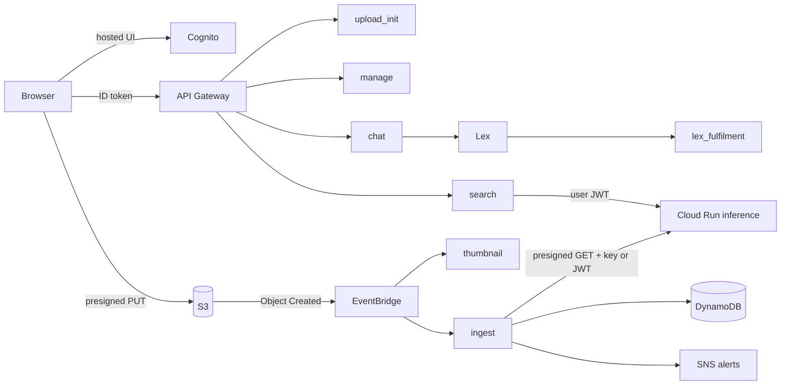

# Aussie EcoGuard: Friends & Foes

Multi-cloud serverless platform (FIT3184 2026 S2, Assignment 2). Users sign in, upload photos and
videos, the system tags invasive pests and pets with a pre-trained model, and everything can be
searched by tag, by example file, by thumbnail URL, by lost-pet details or through a Lex chatbot.

**Due: Monday 2 November 2026, 23:55.** Demo over Zoom is mandatory.

## Architecture

| Concern | Cloud | Service |
|---|---|---|
| Sign-up, sign-in | AWS | Cognito (hosted UI) |
| API | AWS | API Gateway HTTP API with Cognito JWT authorizer |
| Media storage | AWS | S3 (private, presigned URLs) |
| Metadata | AWS | DynamoDB |
| Event fan-out | AWS | S3 to EventBridge to Lambda |
| Chatbot | AWS | Lex V2 + fulfilment Lambda |
| Alerts | AWS | SNS with tag filter policies |
| ML inference, video frames | GCP | Cloud Run (FastAPI + Ultralytics YOLO + OpenCV) |
| Model weights and config | GCP | Cloud Storage (optional, local file works too) |



Why these choices are made and what they cost: [docs/decisions.md](docs/decisions.md).

## Repo layout

```
template.yaml                  AWS SAM template (everything on AWS)
services/aws/layers/common/    shared Python package used by every Lambda (tags, urls, db, storage)
services/aws/functions/        one folder per Lambda
services/gcp/inference/        Cloud Run service (detector, video frames, auth)
frontend/                      static web app (vanilla JS, Cognito hosted UI)
docs/                          API contract, data model, decisions, Lex bot spec
scripts/                       seed data helper
tests/                         unit tests for the pure logic
```

## Who owns what (change names as you agree)

| Area | Owner | Folders |
|---|---|---|
| Identity, IAM, upload UI | Member A | `template.yaml` (Cognito, API, IAM), `frontend/js/auth.js`, `frontend/js/views/upload.js`, `services/gcp/inference/app/auth.py` |
| Ingest and ML pipeline | Member B | `services/aws/functions/{upload_init,thumbnail,ingest,subscriptions}`, `services/gcp/inference`, `frontend/js/views/tags.js` |
| Queries, chatbot, data ops | Member C | `services/aws/functions/{search,manage,chat,lex_fulfilment}`, `docs/lex-bot.md`, `frontend/js/views/{search,lost,chat}.js` |

Shared and agreed together: `docs/api-contract.md`, `docs/data-model.md`, `services/aws/layers/common`.
Change a contract in a PR that all three review.

## Setup

Prerequisites: Python 3.12, AWS SAM CLI, Docker Desktop (Windows builds need `--use-container`),
Google Cloud CLI, an AWS account (Academy or personal) and a GCP project with billing or credits.

```bash
python -m venv .venv
.venv\Scripts\activate          # PowerShell; use source .venv/bin/activate on macOS/Linux
pip install -r requirements-dev.txt
python -m unittest discover -s tests -v
```

1. **Deploy inference to GCP first** (AWS needs its URL). See
   [services/gcp/inference/README.md](services/gcp/inference/README.md).
2. **Deploy AWS:**
   ```bash
   sam build --use-container
   sam deploy --guided
   ```
   Parameters you will be asked for: `CognitoDomainPrefix` (globally unique), `InferenceUrl`,
   `InferenceApiKey`, `LabRoleArn` (Academy only, leave empty otherwise), `FrontendOrigin`.
3. **Frontend:** copy the stack outputs into `frontend/js/config.js`, then
   ```bash
   cd frontend
   python -m http.server 5500
   ```
   Open http://localhost:5500. Cognito only allows `http` callbacks on localhost, so demo from there
   unless you put the site behind HTTPS.
4. **Lex bot:** follow [docs/lex-bot.md](docs/lex-bot.md), then redeploy with `LexBotId` and `LexBotAliasId`.
5. **Fake data for early query work:**
   ```bash
   python scripts/seed_dummy_data.py --table <TableName output>
   ```

## Status of this scaffold

Written but **not yet deployed or run against real AWS/GCP**. The pure logic (tag matching, URL
parsing, tag editing, frame sampling) has unit tests that pass. Everything else needs a first real
deployment and will have small fixes.

Known gaps to close (also tracked in the team board):

- [ ] Choose and verify a model that actually detects fox, feral pig, cane toad, rabbit (see decisions, ADR 5).
- [ ] Replace the `InferenceApiKey` stack parameter with an SSM/Secret Manager lookup.
- [ ] Least-privilege IAM review (rubric 1.3). On Academy the `LabRole` is used instead.
- [ ] Lost-pet matching beyond species plus manual tags (colour, breed).
- [ ] Frontend polish: error states, loading states, responsive gallery.
- [ ] Keep one Cloud Run instance warm for the demo (HTTP API integrations time out at 30 s).

## Working agreement

See [CONTRIBUTING.md](CONTRIBUTING.md). Everyone commits their own work; commit history is part of
the marking evidence.
